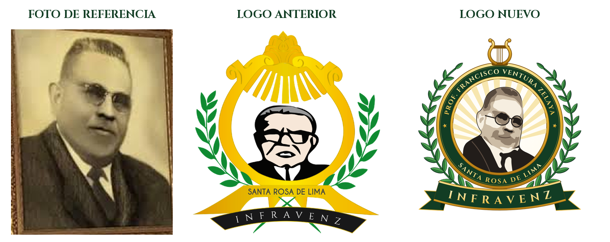

# Logo INFRAVENZ — rediseño

Emblema en honor al **Prof. Francisco Ventura Zelaya** (Santa Rosa de Lima).

| Archivo | Uso |
|---|---|
| `infravenz-logo.svg` | Vector maestro (escala sin pérdida; textos convertidos a trazos) |
| `infravenz-logo-1024.png` / `-512.png` | PNG con fondo transparente |
| `src/generar_logo.py` | Arma el emblema (`python3 src/generar_logo.py`, requiere `fonttools`) |
| `src/retrato.svg` | Retrato vectorizado a partir de la foto del cuadro del profesor |
| `src/vectorizar_retrato.py` | Genera `retrato.svg` desde `src/foto-retrato.jpg` (requiere `opencv-python-headless` y `vtracer`) |
| `src/foto-retrato.jpg` | Foto de referencia: cuadro del Prof. Ventura Zelaya |
| `src/logo-original.png` | Logo original de referencia |

Elementos que se conservan del original: lira, rayos dorados, laureles,
retrato, "SANTA ROSA DE LIMA" y la cinta "INFRAVENZ".

Tipografía: Cinzel (SIL Open Font License).
